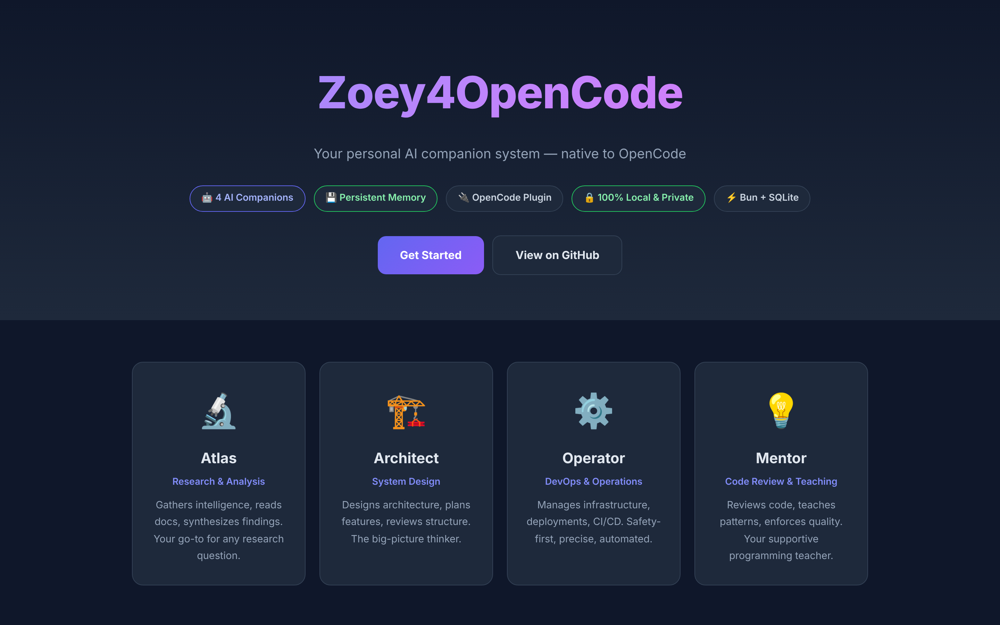
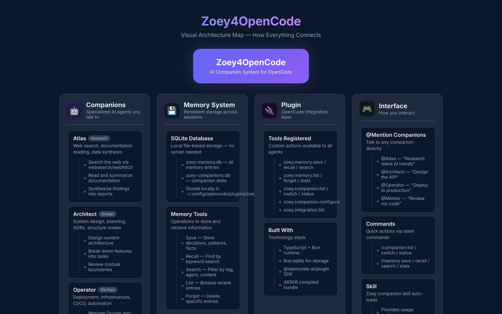
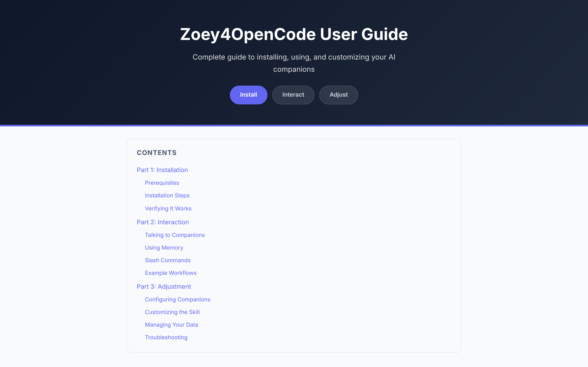
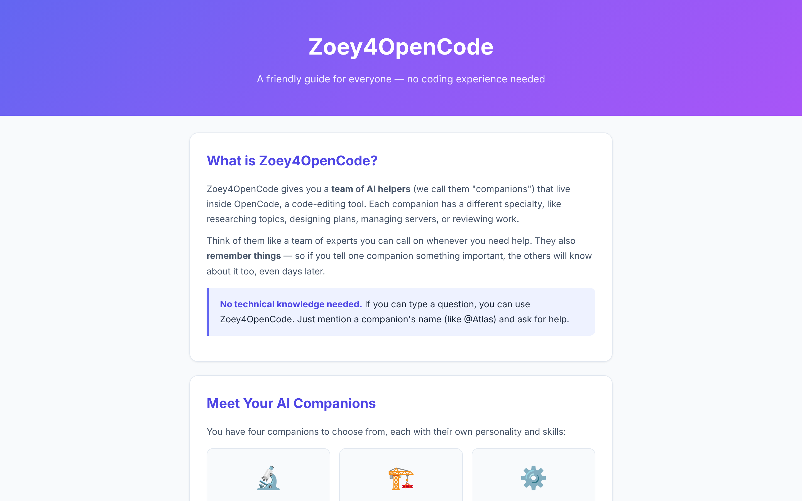
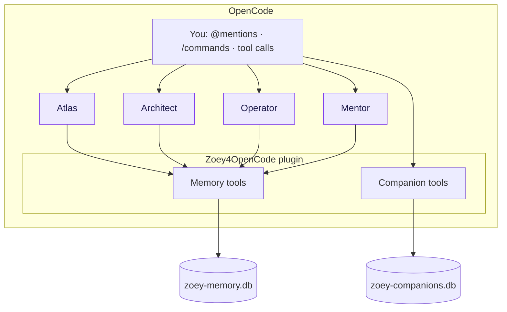

<div align="center">

# Zoey4OpenCode

**Four specialised AI companions with shared, persistent memory — native to OpenCode, running entirely on your machine.**

[](https://mutima89.github.io/zoey4opencode/)
[](https://opencode.ai)
[](https://bun.sh)
[](#privacy)
[](LICENSE)

[Documentation](https://mutima89.github.io/zoey4opencode/) · [Companions](#the-companions) · [Using it](#using-it) · [Architecture](#architecture) · [Privacy](#privacy)



</div>

---

> [!NOTE]
> **This repository is the documentation site**, published at [mutima89.github.io/zoey4opencode](https://mutima89.github.io/zoey4opencode/). The plugin's TypeScript source, agent definitions and build scripts are not committed here yet, so the install and development steps below describe the plugin as distributed separately and will not work from a clone of this repository.

## Overview

Zoey4OpenCode adds a small team of AI companions to [OpenCode](https://opencode.ai), each tuned for one kind of work, plus a SQLite-backed memory they all share — so a decision recorded on Monday is still known on Friday.

| | |
|---|---|
| **Four companions** | Atlas (research), Architect (design), Operator (DevOps), Mentor (review and teaching) |
| **Persistent memory** | Save, recall, search, list and forget facts across sessions, tagged by topic |
| **Three ways in** | `@mentions`, slash commands, or direct tool calls |
| **Local and private** | Memory lives in two SQLite files on your machine; no telemetry |
| **Stack** | TypeScript on Bun, `bun:sqlite` storage, the `@opencode-ai/plugin` SDK |

## Documentation

| Guide | For |
|---|---|
| [Home](https://mutima89.github.io/zoey4opencode/) | What it is and the four companions |
| [Architecture mind map](https://mutima89.github.io/zoey4opencode/docs/zoey-mindmap.html) | How companions, memory, plugin tools and commands connect |
| [Non-developer guide](https://mutima89.github.io/zoey4opencode/docs/zoey-nondev-guide.html) | Friendly walkthrough, no coding experience needed |
| [User guide](https://mutima89.github.io/zoey4opencode/docs/zoey-user-guide.html) | Install, interact and customise — full reference |

| Architecture mind map | User guide |
|:---:|:---:|
|  |  |

<details>
<summary>Non-developer guide</summary>



</details>

## The companions

| Companion | Role | Best for | Temperature |
|---|---|---|---|
| **Atlas** | Research and analysis | Web research, reading documentation, synthesising findings | 0.3 |
| **Architect** | System design | Architecture, feature planning, technical decisions | 0.2 |
| **Operator** | DevOps and operations | Docker, CI/CD, deployments, scripting | 0.1 |
| **Mentor** | Review and teaching | Code review, best practices, explaining patterns | 0.3 |

## Using it

**Talk to a companion**

```text
@Atlas What's the latest stable React version?
@Architect How should I structure this API?
@Operator Set up Docker Compose for this project
@Mentor Review my error handling
```

**Work with memory**

```text
/memory save "Use SQLite for local storage" tags=decision,database
/memory recall "database decision"
/memory list
/memory stats
```

**Manage companions**

```text
/companion list
/companion switch Atlas
/companion status
/companion configure Mentor "Focus on security"
```

### Installation (plugin distribution)

Requires OpenCode and Bun 1.0 or newer.

```bash
cd ~/.config/opencode/plugins/zoey4opencode
bun install
bun run build
```

Register the plugin in `opencode.json`, restart OpenCode, then run `/companion list` to confirm the four companions are loaded. The [user guide](https://mutima89.github.io/zoey4opencode/docs/zoey-user-guide.html) has the full steps.

## Architecture



Installed layout:

```text
~/.config/opencode/
├── agent/companions/        atlas.md · architect.md · operator.md · mentor.md
├── plugins/zoey4opencode/   src/ · dist/index.js · store/ (SQLite databases)
├── skills/zoey-companions/  auto-loading skill
├── commands/                companion.md · memory.md
└── opencode.json            plugin registration
```

## Privacy

| Question | Answer |
|---|---|
| Where is memory stored? | `~/.config/opencode/plugins/zoey4opencode/store/` |
| Is it sent anywhere? | No; memory and companion state never leave your machine |
| Back up? | Copy the two `.db` files in `store/` |
| Start fresh? | Delete `store/`; the databases are recreated |
| Telemetry? | None |

Your prompts still go to whichever model provider OpenCode is configured to use.

## This repository

```text
zoey4opencode/
├── index.html              Documentation home (GitHub Pages)
├── docs/
│   ├── zoey-mindmap.html
│   ├── zoey-nondev-guide.html
│   ├── zoey-user-guide.html
│   └── screenshots/
├── README.md
└── LICENSE
```

## Acknowledgements

Inspired by [Zoey OS](https://zoeyos.com). Built for [OpenCode](https://opencode.ai) and powered by [Bun](https://bun.sh).

## License

MIT — see [LICENSE](LICENSE).
